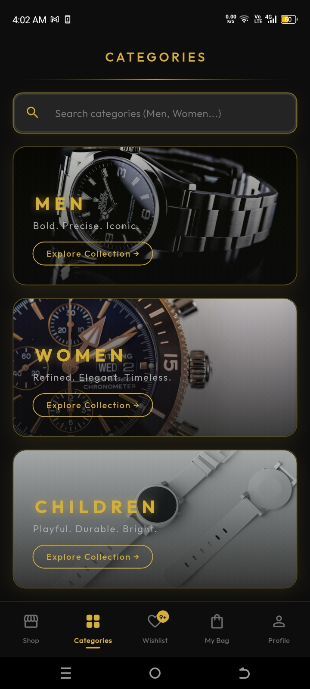
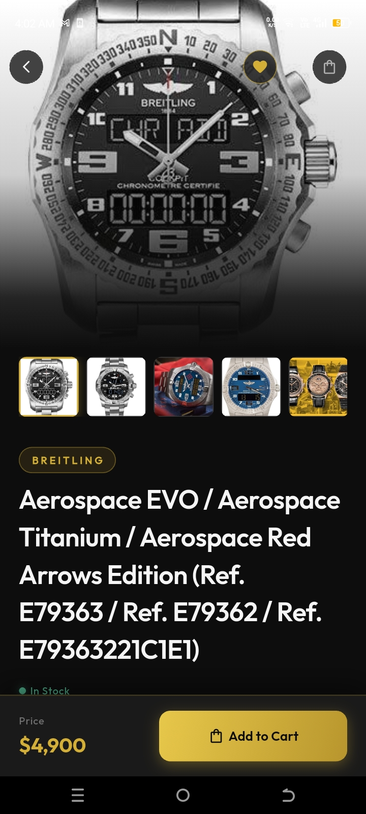
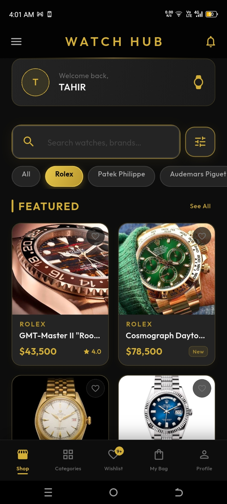
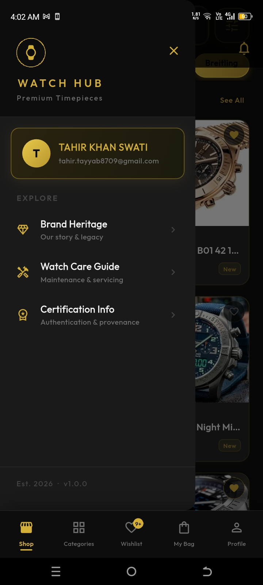

# WatchHub

A premium e-commerce app for luxury watch shopping. Users can explore featured collections, search and filter by brand, save favourites to a wishlist, pick their delivery location on a map, and complete purchases through a smooth cart and checkout flow with multiple payment options.

## Tech Stack

| Layer | Technology |
|-------|-----------|
| Framework | Flutter |
| Language | Dart |
| State Management | Riverpod |
| Backend | Firebase (Authentication and Database) |
| Maps | Map integration for delivery location |
| Payments | Payment method integration at checkout |

## Features

**Shopping**
- **Product browsing:** explore a catalogue of watches with prices, ratings and discount badges
- **Search:** find watches and brands quickly from the home screen
- **Categories and brand filters:** filter products by brand and category
- **Featured collection:** highlighted products and promotional banners on the home screen

**Cart, Payments and Orders**
- **Cart:** add watches to your bag and update items before buying
- **Map integration:** select or confirm the delivery location on a map
- **Payment methods:** choose a payment option at checkout
- **Checkout:** place orders through a simple checkout flow
- **Order management:** keep track of your orders

**User Experience**
- **Wishlist:** save favourite watches to view later
- **User profile:** manage your account details
- **Secure authentication:** sign-up and login powered by Firebase
- **Black and gold UI:** a clean, premium interface designed for luxury products

## Screenshots

  
  
  
  

---
Built by [Tahir Khan](https://github.com/tahirkhan8709)
